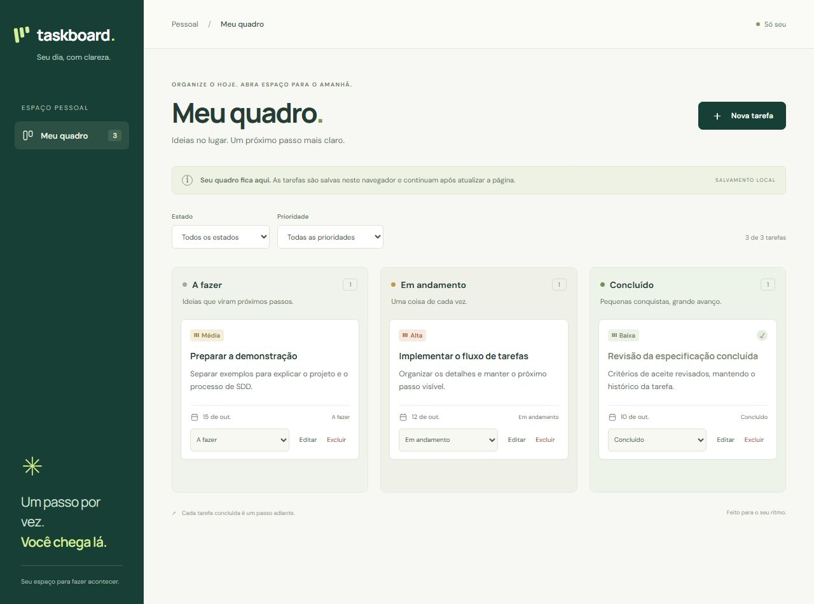

# Taskboard SDD

Quadro de tarefas pessoais em React, TypeScript e Vite, desenvolvido em etapas usando SDD.

## Estado atual

Revisão da sessão 4 em **13/10/2026**: funcionalidades implementadas, percurso completo por teclado e recuperação de falhas de armazenamento conferidos no Chrome. Build, 63 testes e lint aprovados. Os cenários e as evidências estão em [validation.md](validation.md).

Na primeira execução, o quadro começa vazio. As tarefas permanecem após atualizar a página, no mesmo navegador e endereço. A imagem abaixo usa tarefas criadas para a validação; elas não são adicionadas automaticamente à aplicação.



## Objetivo

Praticar Spec-Driven Development (SDD): definir o comportamento esperado, planejar a solução, dividir a implementação em tarefas e validar o resultado contra critérios de aceite.

O usuário pode criar, editar, excluir, organizar e filtrar tarefas. Os dados são armazenados no navegador usando `localStorage`.

## Documentos

| Arquivo | Finalidade |
| --- | --- |
| [spec.md](spec.md) | Escopo, regras e critérios de aceite |
| [plan.md](plan.md) | Decisões técnicas e sequência de implementação |
| [tasks.md](tasks.md) | Trabalho dividido em sessões |
| [validation.md](validation.md) | Verificações vinculadas aos requisitos |
| [progress.md](progress.md) | Histórico real do trabalho e decisões |
| [presentation.md](presentation.md) | Roteiro de apresentação e explicação do SDD |

## Como o SDD foi aplicado

1. Definição do escopo e dos critérios de aceite antes do código.
2. Planejamento técnico e divisão do trabalho em tarefas relacionadas aos requisitos.
3. Implementação e validação dos comportamentos descritos.
4. Esclarecimento da especificação quando a revisão encontrou uma ambiguidade na recuperação do armazenamento.
5. Registro dos resultados reais em `validation.md` e `progress.md`.

O projeto utiliza um fluxo leve em Markdown, inspirado no [GitHub Spec Kit](https://github.github.com/spec-kit/). O toolkit não foi instalado; os documentos foram escritos para este projeto.

O autor escolheu a proposta e o escopo com frontend em React e delegou a execução em sessões. O Codex redigiu os documentos, implementou o código e os testes e apoiou a revisão. O guia de apresentação explica essa participação e as decisões do projeto.

## Limites da primeira versão

Uso individual, sem login ou backend. Os dados ficam no navegador e não são sincronizados entre dispositivos. Arrastar e soltar, notificações e colaboração ficam fora do escopo desta versão.

## Execução

Pré-requisito: Node.js 20.19+ da linha 20, ou Node.js 22.12+; npm.

```sh
npm ci
npm run dev
```

Abra o endereço local informado pelo Vite. Para executar as verificações e gerar a versão de produção:

```sh
npm run check
npm test
npm run lint
npm run build
npm run preview
```

Use `npm run format` para formatar os arquivos de código com Prettier.

## Funcionalidades

- Quadro em três estados, com prioridade e prazo identificados por texto.
- Filtros de estado e prioridade combinados, com mensagem para resultados vazios.
- Criação em A fazer, validação do título e cancelamento do formulário.
- Edição preservando o identificador, o estado e a data de criação.
- Mudança para qualquer um dos três estados e exclusão com confirmação.
- Restauração das tarefas após recarregar, com filtros reiniciados em Todos.
- Avisos para falhas de armazenamento; dados inválidos são preservados até a confirmação para substituí-los.
- Layout para celular e desktop, foco visível, rótulos e fechamento por Escape.
- Retorno do foco após limpar filtros, salvar novamente e descobrir dados inválidos durante a recuperação.

`npm test` executa testes de regras, armazenamento, recuperação de falhas, apresentação dos avisos e callbacks do hook. `npm run lint` aplica as configurações recomendadas de ESLint, TypeScript, React Hooks e JSX accessibility, sem desativar regras, e exige zero avisos. Consulte `validation.md` para o alcance e os resultados de cada verificação.

## Conferir falhas de armazenamento no navegador

Após `npm run dev`, abra `/tests/browser/` no endereço informado pelo Vite. Essa página de validação usa armazenamento simulado em memória e oferece botões para carregar JSON inválido, bloquear leitura ou gravação e liberar o acesso novamente. Ela não lê nem grava o armazenamento real do navegador e não integra o build de produção da aplicação.

Os cenários permitem conferir os avisos, cancelar ou confirmar uma lista vazia, criar durante uma falha de leitura e recuperar tarefas antigas junto das novas. A caixa de conteúdo e o contador de gravações mostram o que foi preservado ou gravado. Reiniciar um cenário descarta apenas os dados simulados.

## Ferramentas de desenvolvimento

As versões estão fixadas no `package-lock.json`. Na sessão 4, TypeScript foi ajustado para 6.0 para atender à compatibilidade declarada de `typescript-eslint`. ESLint 9 foi mantido pela compatibilidade com `eslint-plugin-jsx-a11y`; a instalação informa que essa linha do ESLint está fora de suporte. A configuração passou nas verificações registradas, mas uma atualização futura deve conferir a compatibilidade dos plugins.

## Armazenamento

O aplicativo usa a chave `taskboard-sdd:tasks:v1` e um documento com versão e lista de tarefas. Verifica a estrutura, os campos, as datas e os identificadores antes de restaurar os dados.

Se uma gravação falhar, as alterações continuam disponíveis na sessão e aparece um aviso com a opção de tentar novamente. Se a leitura falhar temporariamente, as tarefas anteriores são recuperadas antes de gravar as tarefas criadas na sessão. Dados inválidos exigem confirmação explícita antes de começar uma lista vazia.
